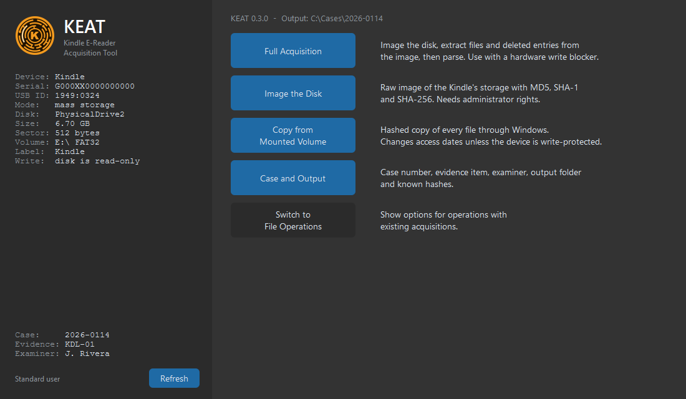
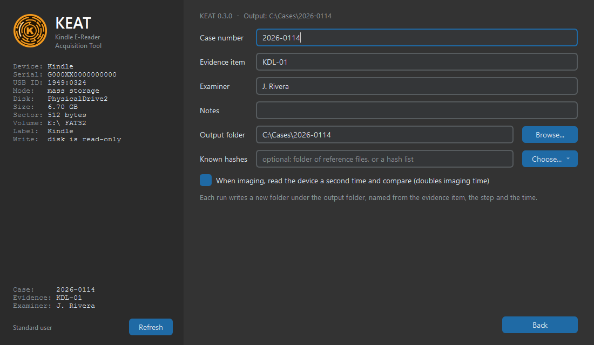
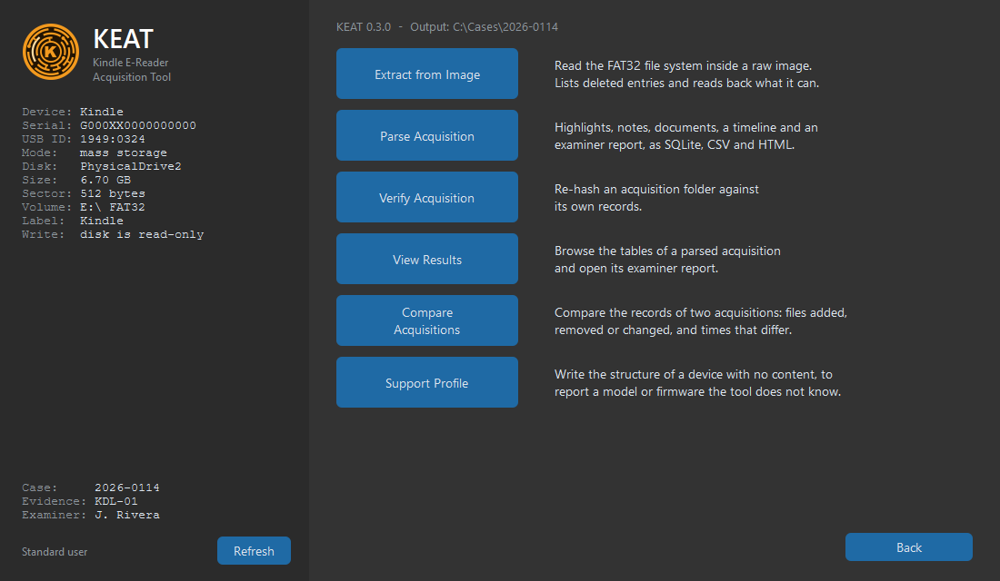
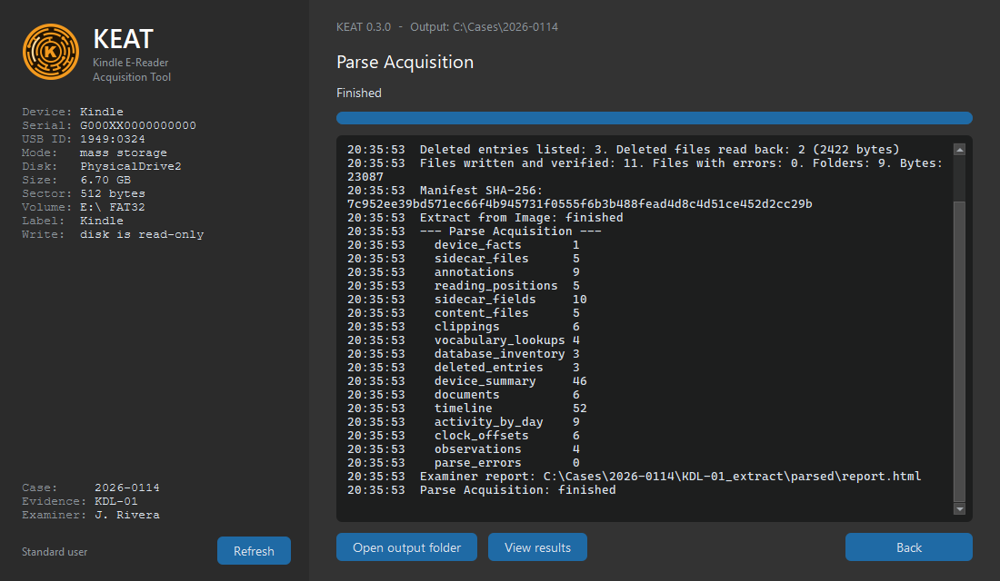
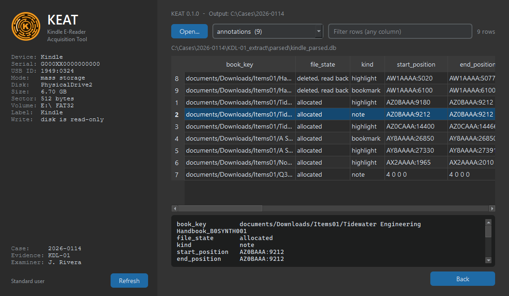
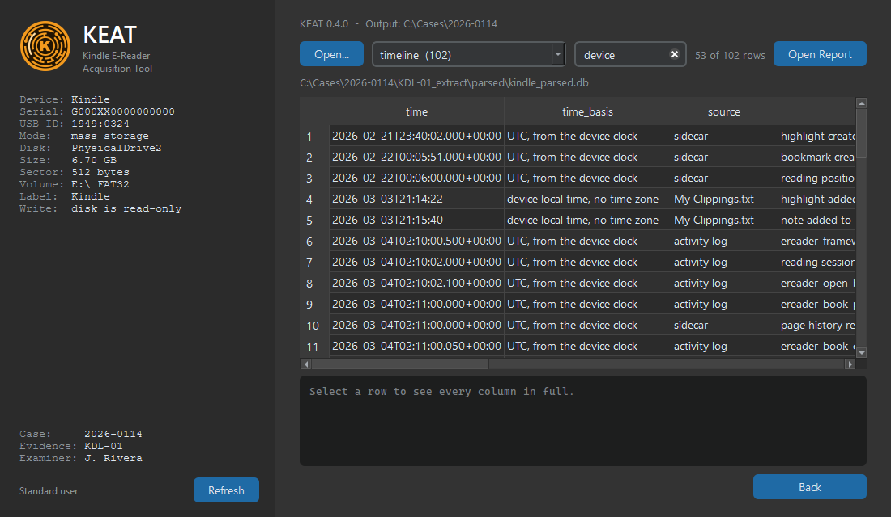
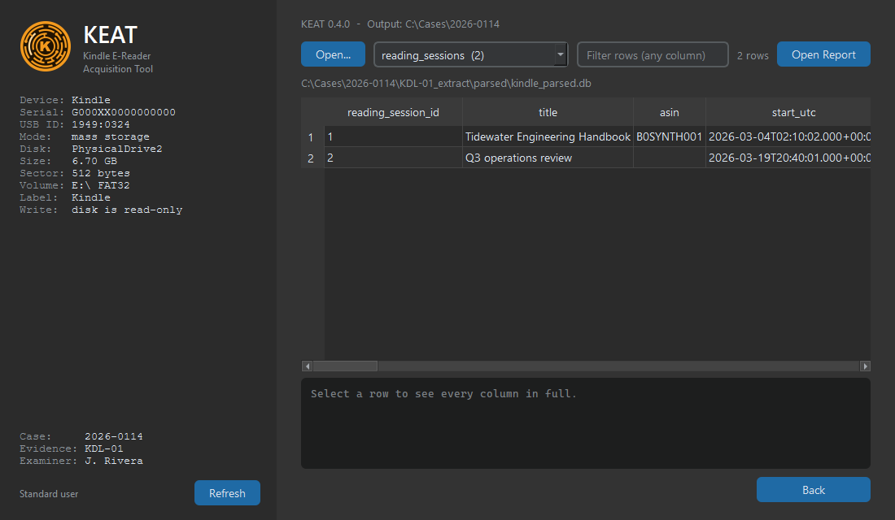
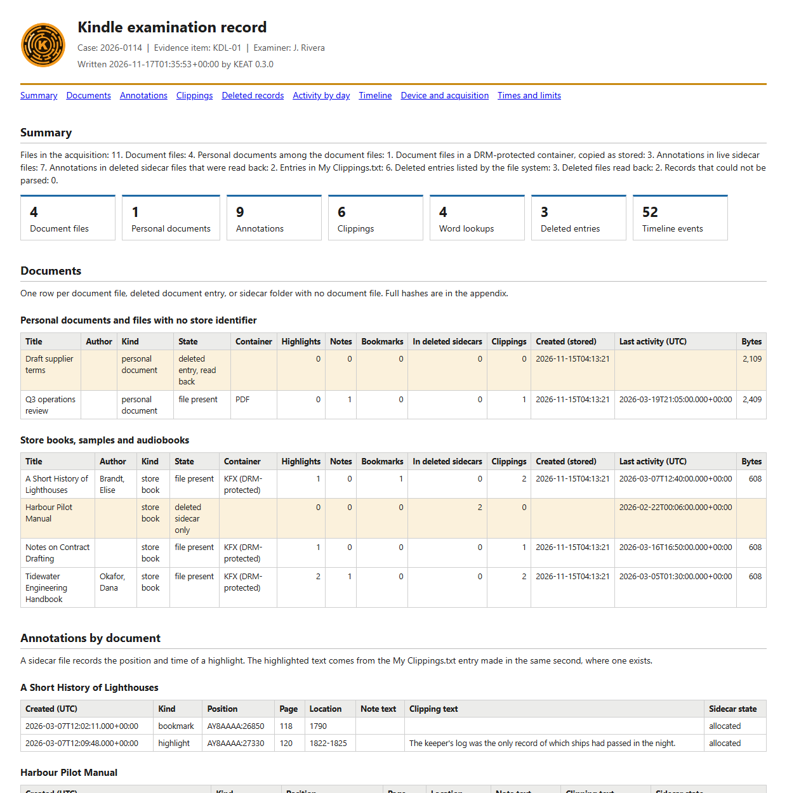

<p align="center">
  
</p>

# KEAT

**Kindle E-Reader Acquisition Tool.** Forensic acquisition and parsing of
Amazon Kindle e-readers.

[](https://github.com/chrisatha/KEAT/actions/workflows/tests.yml)


KEAT images a Kindle's storage, extracts its files and deleted entries
from the image, and parses the records an examiner usually needs:
highlights, notes, bookmarks, reading positions, dictionary lookups,
loaded documents and reading statistics. It then builds a timeline, a
table of documents, a device summary and an examiner report from them.

It copies data as stored. It does not remove, bypass or decrypt DRM.
Protected books are copied and labelled as protected. They are not opened.



*All screenshots show invented data. `tools/make_screenshots.py` rebuilds
them from a synthetic image.*

## Contents

- [What it does](#what-it-does)
- [What it recovers](#what-it-recovers)
- [Install](#install)
- [The window](#the-window)
- [Recommended sequence](#recommended-sequence)
- [Command line](#command-line)
- [Output](#output)
- [Write protection](#write-protection)
- [Times](#times)
- [Limits](#limits)
- [Tested devices](#tested-devices)
- [Tests](#tests)
- [Licence and credits](#licence-and-credits)

## What it does

| Step | Result |
| --- | --- |
| **Detect** | Finds the Kindle by Amazon's USB vendor ID. Reports serial number, disk, volume, and whether the host can write to the device |
| **Image** | Raw image of the storage disk with MD5, SHA-1 and SHA-256. The image file is read back and compared. The device can be read a second time and compared again |
| **Extract** | Reads the FAT32 file system inside the image with KEAT's own reader. Writes every allocated file with hashes, lists deleted entries, and reads deleted files back where their clusters are still unallocated |
| **Copy** | Hashed copy of every file from a mounted volume, for when imaging is not possible |
| **Verify** | Re-hashes an acquisition against its own records and reports changed, missing and added files |
| **Parse** | Decodes the device's records into one SQLite file and one CSV per table. Optional matching against a set of known hashes |
| **Analyse** | Part of Parse. Builds a timeline of every dated record, one row per document, a device summary, activity by day, the device clock offset, and cross-checks between the device's own sources |
| **Report** | Part of Parse. Writes `report.html`, one self-contained page for the examiner's file |
| **Compare** | Compares the records of two acquisitions: files added, removed or changed, and times that differ |
| **Survey** | Writes the structure of a device with none of its content, for reporting a model the tool does not know |

Every file, folder and error gets a row in a manifest. Nothing is skipped
silently. Each run writes a log with the tool version, host, device, case
fields, counts and hashes.

The acquisition code uses the Python standard library only.

## What it recovers

| Record | Source on the device |
| --- | --- |
| Highlights, notes and bookmarks with created and modified times | Sidecar files beside each book or document (`.yjr`, `.yjf`, `.pds`, `.pdt`, `.azw3r` and others) |
| Annotations from books no longer on the device | Deleted sidecar files read back from the image |
| Last page read and other reading positions, with times | Sidecar files |
| The running log of highlights, notes and bookmarks | `My Clippings.txt` |
| Dictionary lookups with the sentence and the book | `system/vocabulary/vocab.db` |
| Loaded books, PDFs and audio files with hashes, container type and the identifier in the file name | `documents/`, `audible/` |
| Reading statistics | `system/freetime/` |
| Reading sessions: book, start, end, page turns, positions and how the book was closed | `system/fmcache/fmcache.db` and its write-ahead log |
| Activity records the device has already removed from its database | Earlier page versions in `fmcache.db-wal` |
| Connection changes (WiFi on and off), sleep, wake and screensaver events | The same activity log |
| Time zone setting, account ID and library counts | The same activity log |
| Last position heard per audiobook, and books linked to audiobooks | `audible/*.db` |
| Store pages viewed and store requests, with times | `.active_content_sandbox/` local storage |
| Web addresses the browser loaded, with times | `system/browser/kindle_browser/` cache |
| Covers of items the device has listed | `system/thumbnails/` |
| Page jumps inside a book, with times | `page.history.store` in sidecar files |
| Deleted file and folder names, sizes, times and first cluster | FAT32 directory entries in the image |
| Every other SQLite database found, with tables and row counts | Whole volume |

## Install

KEAT needs Python 3.8 or later on Windows.

```
git clone https://github.com/chrisatha/KEAT.git
cd KEAT
pip install .[gui]
```

`[gui]` adds PySide6 for the Qt window. Leave it off and KEAT has no
third-party dependency: the command line works and the window falls back
to Tkinter.

To run from a checkout without installing:

```
set PYTHONPATH=src
python -m kindle_acquire detect
```

The command is `kindle-acquire`. `keat` runs the same command.

## The window

Double-click `kindle-acquire-gui.pyw`, or run `kindle-acquire gui`.

Device details stay in the panel on the left: serial number, disk, volume
and whether writes to the device are blocked. The right side is a menu of
actions with a description beside each.

- **Full Acquisition** images the disk, extracts from the image and
  parses the result, in that order. It stops at the first failure.
- **Image the Disk** needs administrator rights. The window offers to
  restart itself elevated. The device is detected again when the step
  starts, and the step stops if that Kindle is no longer connected.
- **Copy from Mounted Volume** warns first when the volume is mounted
  read-write.
- **Case and Output** holds the case number, evidence item, examiner,
  output folder and known hashes.



**Switch to File Operations** shows the steps that work on an existing
acquisition, including Compare Acquisitions and Support Profile.



While a step runs, the window shows its progress and log. **Cancel** stops
a copy, image or extraction. A cancelled run leaves an incomplete folder
with no acquisition log.



**View Results** opens `kindle_parsed.db`. Pick a table, filter rows,
sort by a column, and select a row to read every column in full. The
`file_state` column separates records from allocated files from records
read back from deleted files.



The `timeline` table puts every dated record in one list. Each row names
its time basis and the record it came from.



The `reading_sessions` table has one row per session the device logged.



**Open Report** opens the examiner report of the loaded results in the
default browser.



The Qt window runs on PySide6 or PyQt6. Without either, or with
`kindle-acquire gui --tk`, a Tkinter window with the same steps opens.

## Recommended sequence

1. Keep the Kindle off Wi-Fi. A sync can remove content that was deleted
   from the Amazon account.
2. Connect the Kindle through a hardware USB write blocker.
3. Run **Full Acquisition**, or `image`, then `extract`, then `parse`.
4. Run **Verify** on the image and on the extraction before the work
   leaves the examination computer.

After the image is made the device is not needed again.

## Command line

```
kindle-acquire detect
kindle-acquire image   --out <folder> [--verify-source]        (administrator)
kindle-acquire extract <image folder or image file> --out <folder>
kindle-acquire logical --out <folder>
kindle-acquire verify  <acquisition folder>
kindle-acquire parse   <logical or extracted folder> [--known <folder or hash list>]
kindle-acquire report  <parsed or acquisition folder> [--out <file>]
kindle-acquire compare <acquisition folder> <acquisition folder> [--out <differences.csv>]
kindle-acquire survey  <logical or extracted folder>
kindle-acquire gui     [--tk]
```

`image`, `extract` and `logical` take `--case`, `--evidence`, `--examiner`
and `--notes` for the log.

### detect

Lists USB devices with Amazon's vendor ID (1949). Reports the serial
number, the product ID, the disk number and the mounted volume. Reports
whether the device is a mass-storage disk or an MTP device.

### image

Reads the Kindle's disk (`\\.\PhysicalDriveN`) into a raw image and
computes MD5, SHA-1 and SHA-256. The image file is read back and compared.
`--verify-source` reads the device a second time and compares again.
Unreadable sectors are zero-filled and listed in the log. Needs an
elevated prompt. The image holds unallocated space, which a logical copy
does not.

If the source returns nothing for 4 MiB in a row, the device is treated
as disconnected or failed. The read stops, the log is written with status
`incomplete` and the offset where it stopped, and `verify` fails the
image. A real unreadable area of that size has the same effect.

### extract

Reads the FAT32 file system inside a raw image with the tool's own reader.
Nothing is mounted. The output has the same layout as a logical
acquisition, and `verify` and `parse` work on it.

- Every allocated file is written to `files/`, hashed and read back.
- Times are the FAT values as stored, with no conversion by the host.
- Deleted directory entries are listed in `deleted_entries.csv` with their
  names, sizes, times, first cluster and byte offset in the image.
- A deleted file is read back into `deleted/` when the clusters it would
  occupy as one unbroken run are all unallocated. This is the usual
  assumption for FAT recovery. The content is not confirmed to be the
  original file, and the row says so.
- Broken allocation chains, unreadable folders and two names that share
  one set of clusters are reported as errors. The run continues and the
  log is still written.
- Names in an image are treated as untrusted. Characters Windows cannot
  store are replaced with `_`, reserved device names get a `_` prefix, and
  a second name that would land on the same output path gets `~2`. The
  manifest row records the name as it is on the volume.

### logical

Copies every file from the mounted volume into `<out>/files`.

- Each file is hashed (SHA-256 and MD5) while it is read from the device.
- The copy is read back and compared with that hash.
- Errors are rows in the manifest.

### verify

Re-hashes an acquisition folder against its own manifest or log. Reports
changed and missing files, and files added under `files/` or `deleted/`.
Recovered deleted files are included.

### parse

Reads a logical or extracted acquisition (the copies, never the device)
and writes `parsed/kindle_parsed.db` plus one CSV per table:

| Table | Content |
| --- | --- |
| `content_files` | Books, PDFs and audio files: hashes, container type, ASIN or cdeKey from the file name, sidecar folder, annotation count |
| `annotations` | Highlights, notes and bookmarks from sidecar files, with created and modified times. `file_state` says whether the sidecar file was allocated or deleted and read back |
| `reading_positions` | Last page read and similar positions, with times |
| `clippings` | Entries from `My Clippings.txt` |
| `vocabulary_lookups` | Dictionary lookups with the sentence and the book |
| `sidecar_fields` | Every field of every sidecar file, decoded |
| `database_inventory` | Every SQLite database found, with tables and row counts |
| `freetime_*`, `fmcache_*` | Reading statistics and the activity log tables as SQLite returns them now |
| `activity_records` | Every activity record found in `fmcache.db` and in every page version of its write-ahead log. `state` is `current row` or `earlier page version` |
| `reading_sessions` | One row per reading session: title, start, end, seconds, page turns, first and last position read, how the book was closed |
| `app_sessions` | One row per wake-to-sleep session, with the time zone setting, serial number, account ID and software version the device recorded in it |
| `connectivity` | Connection changes with times |
| `power_events` | Power state changes, screensaver events, wake-ups from hibernation with the reason |
| `page_history` | Positions the reader jumped from, with times, from sidecar files |
| `audiobook_positions`, `audiobook_links` | Last position heard per audiobook with the device that set it, and the books linked to audiobooks |
| `store_storage` | What the store pages saved: pages requested, with times and the full saved value |
| `browser_cache` | One row per browser cache entry: address, host, creation time in UTC where the cache records one |
| `thumbnails` | Covers by item, and whether the item's file is on the device |
| `deleted_entries` | Deleted directory entries and recovery results (extracted images only) |
| `known_matches` | Files whose hash is in the reference set given with `--known` |
| `parse_errors` | Every file a parser could not read, with the reason |

Six analysis tables are built from the rows above. They read nothing
else, and each row names the record it came from:

| Table | Content |
| --- | --- |
| `device_summary` | Serial number, model indicated by the serial number, firmware, USB ID, volume, case fields, hashes, counts of content and records, earliest and latest times, device clock offsets. Each row names its source |
| `documents` | One row per document file, deleted document entry, or sidecar folder with no document file. Title, kind (store book, store sample, personal document, audiobook), state, container, counts of highlights, notes, bookmarks, clippings and lookups, first and last activity, hashes |
| `timeline` | Every dated record in time order: annotations, reading positions, clippings, lookups, reading statistics, queued activity records, and created and modified times of live and deleted files. `time_basis` names the clock each time comes from |
| `activity_by_day` | Counts of timeline events per date, by source |
| `clock_offsets` | Each clipping paired with the sidecar annotation made in the same second. The difference is the device's UTC offset at that moment |
| `observations` | Cross-checks: clippings with no sidecar annotation, clippings found only in a deleted sidecar, annotations with no clipping, sidecars with no document, deleted documents, the same content at two paths, known hash matches, and device times before November 2007 or after the acquisition |

Parse also writes `parsed/report.html`, the examiner report: summary
counts, documents, annotations by document with the clipping text beside
each, clippings, reading sessions, audiobooks, connection and power
events, store and browser records, cross-checks, activity by day, a
timeline, device and acquisition details, and the limits that apply.
It is one file with no scripts and no outside links. Text from the device
is escaped. Its SHA-256 is in `report.html.sha256`.

`--known` takes a folder of reference files, or a text or CSV file with
one MD5 or SHA-256 per line. Every file in the acquisition and every
recovered deleted file is compared. A match means the content is
identical. No match does not show the document was never on the device:
a converted or edited copy has a different hash.

### report

Writes the examiner report again from an existing `kindle_parsed.db`, for
example to another file with `--out`. It needs the analysis tables. Parse
an acquisition that was parsed by version 0.2.0 or earlier again first.

### compare

Compares two acquisitions of the same kind from their records. For
extractions and logical copies it lists paths found on one side only,
and files whose size, SHA-256, stored times, attributes or status
differ. For images it compares the hashes. No file content is re-read:
run `verify` first if a folder may have been altered. The exit code is 0
when both hold the same files with the same hashes.

Three uses: checking a change to the tool against an earlier extraction
of the same image, checking an extraction against a copy made through
Windows, and seeing what changed on a device between two acquisitions.

### survey

Writes `support_profile.json`: file types by area, recognised file
signatures, sidecar field names with the shape of their values, database
table and column names with row counts, and the kinds of parse error.

It is meant to be attached to a report about a model or firmware the
tool does not handle. It leaves out file names in the documents area,
titles, text, annotation content, times of use, account identifiers, the
volume label and all but the first six characters of the serial number.
It is plain JSON. Read it before sharing it.

[docs/NEW_DEVICE.md](docs/NEW_DEVICE.md) is the checklist for testing a
new model.

## Output

The window names each output folder from the evidence item, the step and
the time. On the command line the folder is whatever `--out` names.

An image acquisition:

```
<evidence>_image_<date>_<time>/
    <evidence>.dd                  raw image
    acquisition_log.json           device, case, hashes, unreadable ranges
    acquisition_log.json.sha256
```

An extraction or a logical copy:

```
<evidence>_extract_<date>_<time>/
    files/                         every allocated file, in its folders
    deleted/                       deleted files that were read back (extraction only)
    manifest.csv                   one row per file and folder
    deleted_entries.csv            one row per deleted entry (extraction only)
    acquisition_log.json
    acquisition_log.json.sha256
    parsed/
        kindle_parsed.db           every parsed table
        csv/                       the same tables, one CSV each
        parse_log.json
        report.html                the examiner report
        report.html.sha256
```

Names and text on a device are written by its user. In the files under
`csv/`, a value that a spreadsheet would run as a formula starts with an
added apostrophe. `kindle_parsed.db` holds the value as the device wrote
it. `manifest.csv` and `deleted_entries.csv` hold names as stored, since
`verify` and `parse` read them back. Open those two as text.

## Write protection

A Kindle in mass-storage mode is a FAT32 disk. Windows writes to a FAT32
volume when it mounts it and updates access dates when files are read. In
testing, one logical run changed the access date of 2,392 of 2,836
entries on the device.

For evidence, connect the Kindle through a hardware USB write blocker and
image the disk. Copy from a mounted volume only when a write blocker
cannot be used, and say so in the report. KEAT reports whether the disk
is read-only and whether the host's USB write-protect policy is on.

## Times

Three kinds of time appear in the output. They are not interchangeable.

- `*_utc` in parsed tables: millisecond values the device wrote inside its
  own files. These are UTC.
- `*_stored` in the manifest: the FAT directory time as stored. FAT has no
  time zone. On the tested device the Kindle wrote UTC.
- `*_utc` in the manifest of a logical copy: the host's conversion of the
  FAT time. Windows assumes host local time, which shifts a Kindle's times
  by the host's UTC offset. Prefer `*_stored`.
- `added_device_local` in `clippings`: the clock time the device printed,
  in the device's time zone setting.

The `timeline` table holds all of them in one list and names the basis of
each row. Rows in different bases are in true order only after the
device's UTC offset is applied. `clock_offsets` gives that offset for each
moment where a clipping and a sidecar annotation record the same event.

[docs/METHOD.md](docs/METHOD.md) records how each of these was
established, with the test figures.

## Limits

- MTP devices (Kindle Scribe, 2024 models) are detected but not yet copied.
- Scribe notebooks are not exposed over USB and are out of reach of this
  version.
- The system partition (content catalog, system logs) is not reachable
  over USB.
- Raw images are single-file `dd`. No E01, no split files.
- `extract` reads FAT32 only. Deleted files stored in more than one run of
  clusters are not recovered. Unallocated space is not carved.
  [docs/METHOD.md](docs/METHOD.md) has the limits on deleted names and
  recovery.
- CSV output holds device text unchanged. A cell that starts with `=` is
  a formula to a spreadsheet program. Open the CSV files as text or use
  the SQLite file.
- The window's image and copy steps have been run against synthetic
  data, not yet against a device. The functions behind them have.
- KEAT has not yet been tested with the Kindle behind a hardware write
  blocker. The device tests were made on a direct USB connection.
- The activity log holds what the device had not yet discarded. On the
  test device it covered 16 hours in detail and one session four days
  earlier. It is not a full history of use.
- A row marked `earlier page version` was in the database once. The log
  does not say when it was removed.
- The device does not store WiFi network names or passwords on the USB
  volume. The activity log says when the connection changed. The browser
  cache can hold the sign-in page of a network.
- A cover in `thumbnails` shows the device listed the item. It does not
  show the item was downloaded or opened.
- The model name in `device_summary` comes from a community list of
  serial number codes. It covers four models and is an indication only.
- Titles come from the device's databases where an ASIN matches, else from
  the file name. A clipping is linked to a document by comparing titles.
- Note text in sidecar files is decoded by position. It is covered by a
  synthetic test and has not been checked against a device that holds notes.

## Tested devices

| Model | Serial prefix | Firmware | USB ID | Mode | Result |
| --- | --- | --- | --- | --- | --- |
| Kindle (serial code indicates Paperwhite 11th generation, to confirm on the device) | G001PX | 5.19.2 | 1949:0324 | mass storage | logical, image, extract, verify, parse |

On that device the image was read twice with matching hashes, and the
extraction from the image matched a logical copy for all 2,541 files.
Reports from other models and firmware versions are welcome.

## Tests

```
python -m unittest discover -s tests
```

Tests use synthetic data, including FAT32 images built in memory. Do not
add device data to this repository.

- **Unit tests** cover each command and parser.
- **Regression test**: an invented Kindle (`tests/synthetic_kindle.py`)
  is extracted and parsed, and the whole result is compared with
  `tests/golden/synthetic_kindle.json`. After an intended change, set
  `KEAT_UPDATE_GOLDEN=1`, run the tests, and review the diff of that file.
- **Fuzz tests** damage the image, sidecar files and clippings text with
  seeded random changes. The tool must report the damage, keep its output
  inside the output folder and leave a folder that verifies. Set
  `KEAT_FUZZ=10` for ten times as many cases.
- **Fault tests** image a source with unreadable sectors and one that
  stops responding.
- **Window tests** start both windows.

The same tests run on GitHub for Windows and Linux on each push.

## Licence and credits

MIT. See [LICENSE](LICENSE).

The window's layout follows the UFADE and ALEX extraction tools by
Christian Peter. No code or assets from those projects are used.

Use KEAT only on devices you are authorised to examine.
